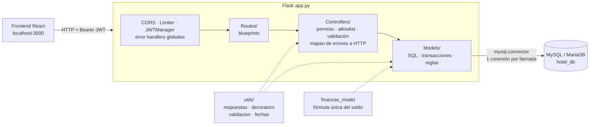
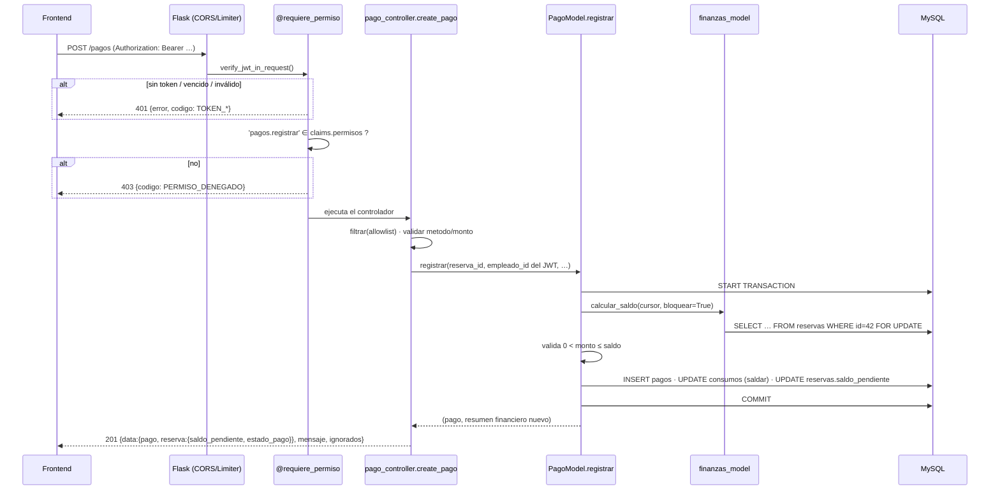
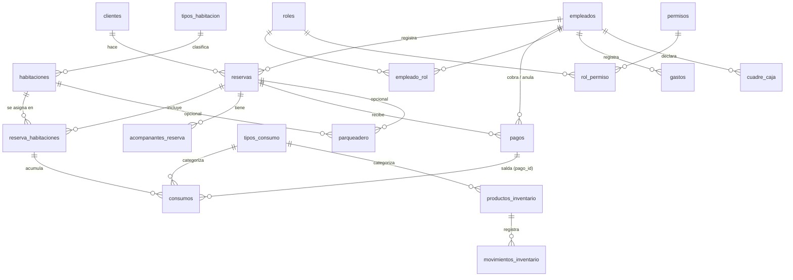
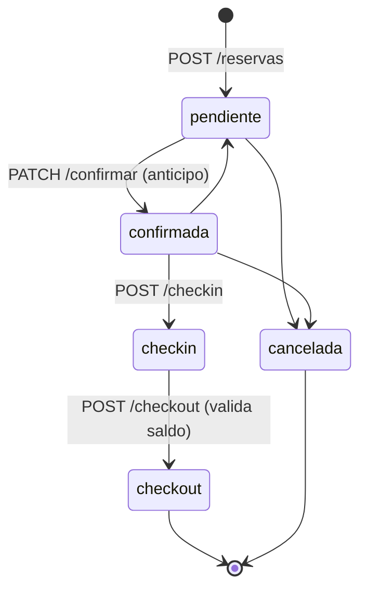
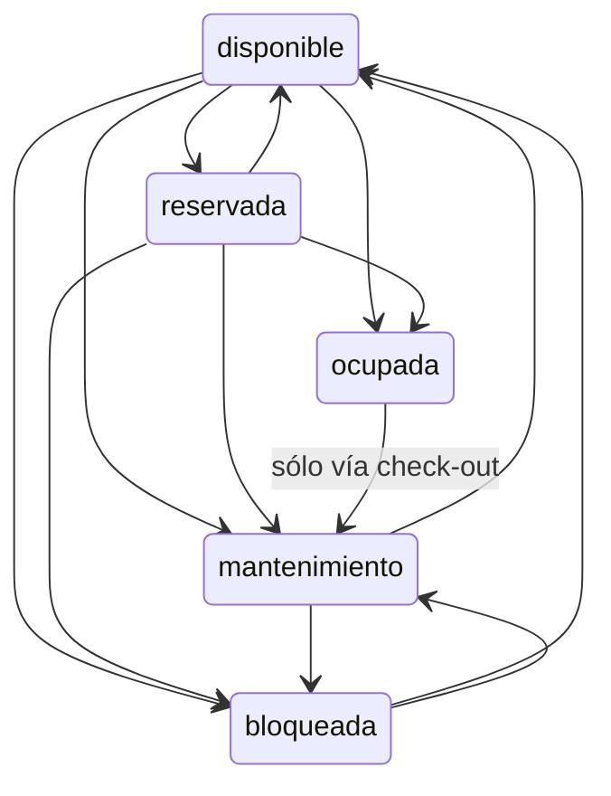
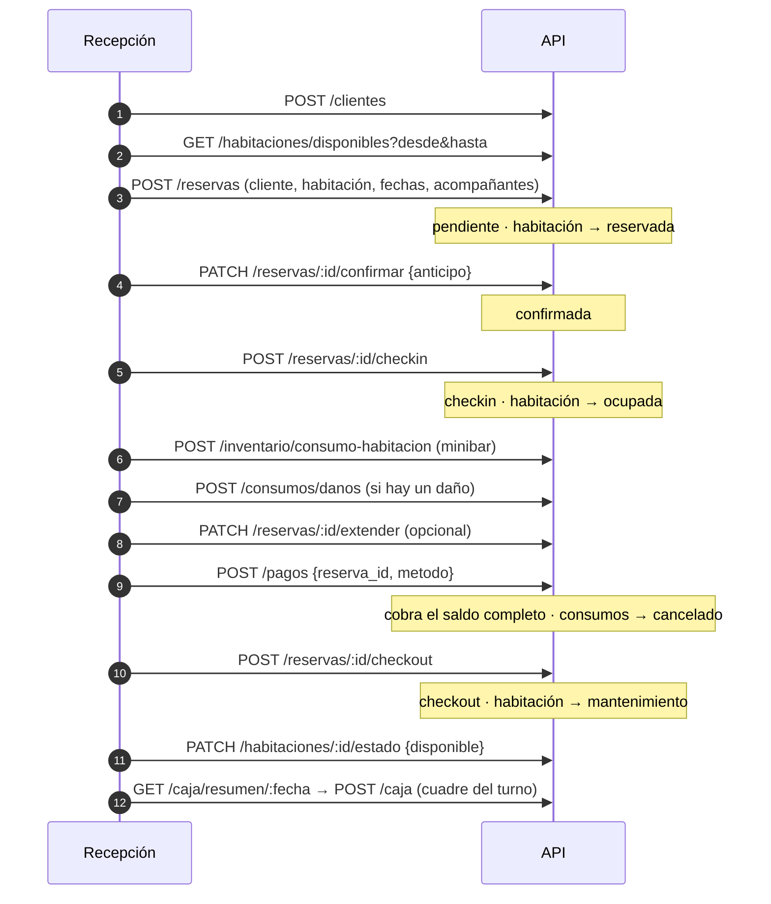

# Ecosistema del Backend — RegyHotel (RegystockHotel)

> Documento de referencia técnica generado a partir de la lectura completa del
> código fuente (app, configuración, `utils/`, 8 blueprints, 15 modelos,
> 14 controladores, migraciones y pruebas). Fecha de revisión: 2026-09-11.
>
> **Cómo leerlo:** las secciones 1–13 describen *cómo es* el sistema. La
> sección 14 es la *revisión*: errores confirmados, riesgos y deuda técnica,
> ordenados por gravedad. La sección 15 propone un plan de acción.

---

## Índice

1. [Resumen ejecutivo](#1-resumen-ejecutivo)
2. [Stack tecnológico](#2-stack-tecnológico)
3. [Estructura del repositorio](#3-estructura-del-repositorio)
4. [Arquitectura y ciclo de vida de una petición](#4-arquitectura-y-ciclo-de-vida-de-una-petición)
5. [Configuración, arranque y despliegue](#5-configuración-arranque-y-despliegue)
6. [Infraestructura transversal (`utils/` y `finanzas_model`)](#6-infraestructura-transversal)
7. [Modelo de datos](#7-modelo-de-datos)
8. [Autenticación y autorización](#8-autenticación-y-autorización)
9. [Módulos de dominio](#9-módulos-de-dominio)
10. [Catálogo completo de endpoints](#10-catálogo-completo-de-endpoints)
11. [Flujo de negocio de punta a punta](#11-flujo-de-negocio-de-punta-a-punta)
12. [Transacciones y concurrencia](#12-transacciones-y-concurrencia)
13. [Migraciones y pruebas](#13-migraciones-y-pruebas)
14. [Revisión: hallazgos](#14-revisión-hallazgos)
15. [Plan de acción recomendado](#15-plan-de-acción-recomendado)
16. [Glosario](#16-glosario)

---

## 1. Resumen ejecutivo

**RegyHotel** es una API REST para gestionar la operación de un hotel:
reservas, habitaciones, huéspedes y acompañantes, consumos (minibar, daños,
servicios), pagos y anulaciones, inventario, gastos, parqueadero y cuadre de
caja, además de la administración de empleados, roles y permisos.

| Dato | Valor |
|---|---|
| Lenguaje / runtime | Python **3.13.13** (`.python-version`) |
| Framework | **Flask 3.1** con blueprints |
| Acceso a datos | **`mysql-connector-python` con SQL escrito a mano** (no hay ORM) |
| Base de datos | MySQL / **MariaDB** (XAMPP en local, puerto 3307) |
| Autenticación | JWT (`Flask-JWT-Extended`), 8 h de vigencia |
| Autorización | RBAC: empleado → roles → permisos, con los permisos embebidos en el JWT |
| Servidor de producción | `gunicorn` (Procfile, estilo Heroku/Railway) |
| Tamaño | ~6.000 líneas de Python · **114 endpoints** (método + ruta) · 19 tablas |
| Pruebas | 2 scripts de aceptación e integración contra la BD real (51 comprobaciones) |

**Estado general.** El núcleo está bien pensado: el servidor es la única
fuente de verdad del dinero, las operaciones críticas son transaccionales con
bloqueo de filas (`SELECT … FOR UPDATE`), todas las respuestas usan un mismo
formato, hay allowlists contra *mass assignment* y la zona horaria está
resuelta de forma explícita.

**Lo más urgente que encontré en la revisión** (detalle en §14):

1. 🔴 **La fórmula del saldo resta dos veces los consumos pagados.** Cobrar un
   consumo de $50.000 baja la deuda en $100.000. Comprobado ejecutando
   `finanzas_model.resumen()`.
2. 🔴 **`PATCH /reservas/:id/estado` se salta todas las reglas del check-out y
   la cancelación**: permite cerrar una reserva con deuda sin el permiso
   `checkout.forzar`, y cancelar una reserva con pagos sin motivo.
3. 🔴 **Hay escalada de privilegios a través de `/roles`**: quien tenga
   `roles.gestionar` puede darse cualquier permiso o renombrar su rol a
   `admin`.
4. 🟠 **La migración usa sintaxis exclusiva de MariaDB** y **la zona horaria
   depende de la configuración del servidor MySQL**. Las dos cosas fallan en
   un MySQL 8 en la nube (Railway usa por defecto UTC y MySQL 8).
5. 🟠 **Los anticipos no pasan por `pagos`**, así que no aparecen en el
   resumen de caja del día.

---

## 2. Stack tecnológico

### 2.1 Dependencias (`requirements.txt`)

| Paquete | Versión | Rol en el proyecto |
|---|---|---|
| Flask | 3.1.3 | Framework web, blueprints, manejo de errores |
| flask-cors | 6.0.2 | CORS para el frontend React (`http://localhost:3000`) |
| Flask-JWT-Extended | 4.7.3 | Emisión y validación de JWT; *loaders* de errores 401 |
| PyJWT | 2.12.1 | Dependencia de Flask-JWT-Extended |
| Flask-Limiter | 4.1.1 | Límite de peticiones (5/min en `/auth/login`) |
| limits, Deprecated, wrapt, ordered-set | — | Dependencias de Flask-Limiter |
| mysql-connector-python | 9.7.0 | Driver de MySQL/MariaDB (conexión directa, sin pool) |
| gunicorn | 26.0.0 | Servidor WSGI en producción |
| Werkzeug, Jinja2, MarkupSafe, itsdangerous, click, blinker | — | Dependencias de Flask |
| colorama, packaging, typing_extensions | — | Utilidades transitivas |

> ⚠️ `requirements.txt` está guardado en **UTF-16 LE con BOM** (bytes
> `FF FE`), probablemente por un `pip freeze > requirements.txt` desde
> PowerShell. `pip` lo tolera, pero otras herramientas (detectores de
> buildpacks, Dependabot, `grep`) no. Conviene guardarlo en UTF-8.

### 2.2 Lo que **no** se usa (aclaración importante)

- **No hay ORM (SQLAlchemy u otro).** Todo el acceso a datos es SQL
  parametrizado (`%s`) sobre cursores de `mysql.connector`, casi siempre con
  `cursor(dictionary=True)`.
- **No hay pool de conexiones**: cada método de cada modelo abre y cierra su
  propia conexión con `get_connection()`.
- **No se carga `.env`**: `.env` está en `.gitignore`, pero no hay
  `python-dotenv`; la configuración sale únicamente de `os.environ`.
- **No hay `__init__.py`** en `Models/`, `Controllers/`, `Routes/` ni
  `utils/`: funcionan como *namespace packages* de Python 3. Funciona, pero
  es implícito.

---

## 3. Estructura del repositorio

```
RegystockHotel/
├── app.py                  # Punto de entrada: crea la app, CORS, JWT, limiter,
│                           # manejadores de error y registro de blueprints
├── Config.py               # Configuración de la BD y del JWT desde variables de entorno
├── database.py             # get_connection(): una conexión nueva por llamada
├── extensions.py           # Instancia compartida de Flask-Limiter
├── Procfile                # web: gunicorn app:app --bind 0.0.0.0:$PORT
├── .python-version         # 3.13.13
├── requirements.txt        # (UTF-16, ver §2.1)
│
├── Routes/                 # 8 blueprints: sólo mapean URL → función de controlador
│   ├── auth_routes.py
│   ├── cliente_routes.py
│   ├── habitacion_routes.py            # habitaciones + tipos de habitación
│   ├── empleado_routes.py              # empleados + roles + permisos
│   ├── reserva_routes.py               # reservas + acompañantes
│   ├── consumo_pago_routes.py          # consumos + tipos de consumo + pagos
│   ├── inventario_routes.py
│   └── gasto_parqueadero_caja_routes.py
│
├── Controllers/            # 14 controladores: permisos, allowlist, validación,
│                           # traducción de errores del modelo a HTTP
├── Models/                 # 15 modelos: SQL, transacciones y reglas de negocio
│   └── finanzas_model.py   #   ← la fórmula ÚNICA del saldo
│
├── utils/
│   ├── respuestas.py       # Formato {data}/{error,codigo} y serialización JSON
│   ├── decorators.py       # @requiere_permiso, empleado_actual_id(), es_admin()
│   ├── validacion.py       # Allowlists, a_decimal, a_entero, fusionar
│   └── fechas.py           # Zona horaria de Bogotá, normalización de fechas
│
├── migrations/
│   ├── 001_backend_spec.sql   # Cambios de esquema (idempotente, sintaxis MariaDB)
│   └── run.py                 # Ejecutor de migraciones
│
├── tests/
│   ├── test_aceptacion.py     # 46 comprobaciones HTTP con test_client
│   └── test_concurrencia.py   # 5 comprobaciones con hilos reales y fallos inyectados
│
├── RESPUESTA_BACKEND.md    # Contrato entregado al equipo de frontend
└── ECOSISTEMA_BACKEND.md   # Este documento
```

> El **esquema base de la BD no está en el repositorio**. `001_backend_spec.sql`
> sólo altera tablas que ya existían. Con el repo solo no se puede montar un
> entorno desde cero (ver §14, H-17).

---

## 4. Arquitectura y ciclo de vida de una petición

### 4.1 Capas

El proyecto sigue un **MVC sin vistas** (API pura), con reparto claro de
responsabilidades:



| Capa | Responsabilidad | Lo que **no** hace |
|---|---|---|
| **Routes** | Declarar `URL + método → función` | No tiene lógica (salvo el `OPTIONS /pagos` y el `limiter` del login) |
| **Controllers** | `@requiere_permiso`, `filtrar()` con la allowlist, validar tipos y rangos, tomar `empleado_id` del JWT, traducir los códigos del modelo a HTTP con `respuestas.*` | No escribe SQL |
| **Models** | SQL, transacciones, bloqueos, máquinas de estado, cálculo de totales | No conoce `request` ni HTTP (salvo el `recalcular_estado_habitacion`, que admite un cursor externo) |
| **utils** | Piezas reutilizables sin estado | — |

### 4.2 Ciclo de vida de una petición típica

Ejemplo: `POST /pagos {"reserva_id": 42, "metodo": "efectivo"}`.



### 4.3 Manejo de errores global ([app.py](app.py))

| Origen | Respuesta |
|---|---|
| Token vencido / inválido / ausente / revocado | `401` con `TOKEN_EXPIRADO`, `TOKEN_INVALIDO`, `NO_AUTENTICADO`, `TOKEN_REVOCADO` |
| Ruta inexistente | `404 NO_ENCONTRADO` |
| Método no permitido | `405 METODO_NO_PERMITIDO` |
| Límite de peticiones | `429 LIMITE_PETICIONES` |
| Cualquier `HTTPException` (p. ej. 415 por no enviar JSON) | Su código, con `HTTP_ERROR` |
| **Cualquier otra excepción** | `500 ERROR_INTERNO`, con el traceback completo en el log del servidor y nunca al cliente |

El patrón de errores de negocio es de dos pasos: **el modelo lanza
`ValueError('codigo_interno')` o devuelve `(resultado, 'estado')`, y el
controlador lo traduce** con un diccionario `{codigo: (mensaje, http, CODIGO)}`.

---

## 5. Configuración, arranque y despliegue

### 5.1 Variables de entorno ([Config.py](Config.py))

| Variable | Valor por defecto | Uso |
|---|---|---|
| `MYSQLHOST` | `127.0.0.1` | Host de la BD |
| `MYSQLUSER` | `root` | Usuario |
| `MYSQLPASSWORD` | *(vacío)* | Contraseña |
| `MYSQLDATABASE` | `hotel_db` | Base de datos |
| `MYSQLPORT` | `3307` | Puerto (el XAMPP local está en 3307) |
| `JWT_SECRET_KEY` | `hotel_bq84_secret_key_2026` ⚠️ | Firma HMAC de los JWT |
| `JWT_ACCESS_TOKEN_EXPIRES` | `28800` (8 h) | Vigencia del token, en segundos |
| `PORT` | — | Lo usa gunicorn en el Procfile |

Los nombres `MYSQL*` son los que inyecta el plugin MySQL de **Railway**, así
que ese parece ser el destino de despliegue.

### 5.2 Arranque local

```bash
# 1. Entorno
python -m venv venv
venv\Scripts\activate
pip install -r requirements.txt

# 2. Base de datos: XAMPP con MariaDB en el puerto 3307 y la BD hotel_db
#    (el esquema base NO está en el repo)
python migrations/run.py

# 3. Servidor de desarrollo (debug=True, puerto 5000)
python app.py

# 4. Pruebas (escriben en la BD real y limpian al terminar)
python tests/test_aceptacion.py
python tests/test_concurrencia.py
```

### 5.3 Producción

- `Procfile`: `gunicorn app:app --bind 0.0.0.0:$PORT` (1 *worker* síncrono por
  defecto).
- **CORS** sólo admite `http://localhost:3000` y está escrito en el código: el
  frontend desplegado quedaría bloqueado (ver H-13).
- **Flask-Limiter** usa almacenamiento en memoria: se reinicia con cada
  despliegue y no se comparte entre *workers* (el propio arranque lo avisa con
  un `UserWarning`).
- `app.run(debug=True)` sólo se ejecuta con `python app.py`, no con gunicorn.

---

## 6. Infraestructura transversal

### 6.1 `utils/respuestas.py` — el contrato de salida

Todas las respuestas pasan por aquí:

```jsonc
{ "data": [ ... ], "total": 128 }                  // lista(filas, total=None, **extra)
{ "data": { ... } }                                 // recurso(fila, status=200, **extra)
{ "data": { ... } }  // con HTTP 201                // creado(fila, **extra)
{ "error": "texto legible", "codigo": "CODIGO" }    // error(msg, status, codigo, **extra)
{ "data": null, "mensaje": "..." }                  // sin_contenido(mensaje)
```

Serialización propia (`serializar`): `Decimal → float`, `datetime/date/time →
ISO-8601`, `timedelta → "HH:MM"` (así llegan las columnas `TIME` como
`hora_llegada`) y `bytes → str`. Se usa `ensure_ascii=False`, así que los
acentos salen tal cual.

Campos extra habituales junto a `data`: `mensaje`, `ignorados` (claves que el
cliente mandó y se descartaron), `limite`/`offset`, `aviso`, `estado_final`…

### 6.2 `utils/decorators.py` — autorización

| Función | Qué hace |
|---|---|
| `@requiere_permiso('x.y')` | Verifica el JWT (401 si falla) y exige el permiso en `claims.permisos` (403 `PERMISO_DENEGADO`) |
| `@requiere_alguno(*permisos)` | Igual, pero con que tenga uno basta. **Definido pero no se usa en ningún sitio** |
| `permisos_actuales()` / `roles_actuales()` | Leen los claims del JWT (los roles toleran la cadena de `GROUP_CONCAT`) |
| `tiene_permiso(p)` | Comprobación suelta dentro de un controlador (p. ej. para `forzar`) |
| `es_admin()` | `'admin' in roles`: se decide **por el nombre del rol** |
| `empleado_actual_id()` | `int(get_jwt_identity())`. **Es la única fuente de `empleado_id`**: nunca se toma del body |

### 6.3 `utils/validacion.py` — allowlists y números

- `CAMPOS_PROHIBIDOS`: campos que ningún endpoint debería aceptar (`estado`,
  `total`, `saldo_pendiente`, `empleado_id`, `rol_id`, `anulado`…). Es
  documental: **la allowlist de cada endpoint manda**.
- `filtrar(data, permitidos, obligatorios=())` → `(limpio, faltantes)`.
  Descarta todo lo no declarado; un obligatorio vacío o con sólo espacios
  cuenta como faltante.
- `descartados(data, permitidos)` → la lista `ignorados` que se devuelve al
  cliente.
- `a_decimal(...)` / `a_entero(...)` → conversión con rango y mensaje legible
  (`ValueError`).
- `fusionar(actual, cambios, permitidos)` → convierte un PUT parcial en una
  fila completa para los modelos que escriben todas las columnas (clientes,
  empleados, acompañantes, tipos de habitación).

### 6.4 `utils/fechas.py` — zona horaria

**Decisión:** la BD guarda las marcas de tiempo en **hora local de Bogotá
(UTC-5, sin horario de verano)**, porque ya había datos históricos escritos
con `CURRENT_TIMESTAMP` en un MySQL con `time_zone = SYSTEM` = Bogotá.

| Función | Uso |
|---|---|
| `ahora_local()` / `hoy_local()` | "Ahora" y "hoy" en Bogotá, no los del servidor |
| `a_datetime_local(v)` | Acepta `…Z` (UTC), `…-05:00` o una hora local sin zona, y devuelve un `datetime` *naive* en hora de Bogotá, listo para escribir |
| `marcar_local(dt)` | Etiqueta un `datetime` leído de la BD para que salga como `…-05:00` |
| `a_fecha(v)` | Normaliza `YYYY-MM-DD` a `date` (`ValueError` si no es válido) |
| `rango_del_dia(d)` | `(inicio, fin)` para filtrar `>= inicio AND < fin` (aprovecha el índice) |
| `noches_entre(a, b)` | `max((b − a).days, 0)` |

Si el sistema no tiene la base de datos de zonas (Windows sin `tzdata`), se
usa un `timezone(-5h)` fijo como respaldo.

### 6.5 `Models/finanzas_model.py` — la fórmula del saldo

Es **el único sitio que decide cuánto se debe**:

```
total_cuenta    = total_reserva + consumos_pendientes
saldo_pendiente = max(total_cuenta − anticipo − pagos_no_anulados, 0)

estado_pago = 'pagada'    si saldo ≤ 0
            = 'parcial'   si anticipo + pagado > 0
            = 'pendiente' en otro caso
```

- `agregados(alias)` inyecta cuatro subconsultas correlacionadas
  (`total_consumos`, `total_consumos_pagados`, `total_pagado` y `noches`) en
  cualquier `SELECT` sobre `reservas`.
- `resumen(fila)` añade `total_cuenta`, `saldo_pendiente` y `estado_pago`.
- `calcular_saldo(cursor, reserva_id, bloquear)` hace lo mismo dentro de una
  transacción abierta, con `FOR UPDATE` opcional.

> 🔴 **Esta fórmula tiene un error de doble conteo** con los consumos pagados.
> Ver H-01.

La columna `reservas.saldo_pendiente` existe en la tabla, pero es **sólo una
caché**: la API siempre devuelve el valor derivado de `resumen()`.

---

## 7. Modelo de datos

> La BD local no estaba accesible durante la revisión (puerto 3307 cerrado),
> así que este esquema se **reconstruyó a partir de las consultas del código**
> y de `001_backend_spec.sql`. Los tipos exactos, los índices y las `FOREIGN
> KEY` originales deben confirmarse contra el volcado real.

### 7.1 Diagrama entidad-relación



### 7.2 Tablas

| Tabla | Columnas relevantes | Notas |
|---|---|---|
| **clientes** | `id, tipo_documento, numero_documento, nombre, apellido, nacionalidad, telefono, email, direccion, empresa, fecha_nacimiento, notas, creado_en` | `numero_documento` es único (el código captura el error `1062`) |
| **empleados** | `id, nombre, apellido, telefono, email, usuario, contrasena, activo, creado_en` | `contrasena` = SHA-256 hex **sin salt** |
| **roles** | `id, nombre, descripcion, activo` | `admin` y `gerente` son roles "privilegiados" por nombre |
| **permisos** | `id, nombre` | Nombres con la forma `modulo.accion` |
| **empleado_rol** | `empleado_id, rol_id` | N:M |
| **rol_permiso** | `rol_id, permiso_id` | N:M |
| **tipos_habitacion** | `id, nombre, descripcion, capacidad, precio_base` | `precio_base` es el precio por defecto de la noche |
| **habitaciones** | `id, numero, piso, tipo_id, tipo_cama, estado, notas_mantenimiento` | `estado` ∈ `disponible, reservada, ocupada, mantenimiento, bloqueada` |
| **reservas** | `id, cliente_id, empleado_id, fecha_reserva, fecha_entrada, fecha_salida, hora_llegada, hora_salida, num_adultos, num_ninos, estado, fuente, anticipo, saldo_pendiente, total, late_checkout, observaciones, creado_en, checkout_forzado_por, checkout_forzado_en, checkout_forzado_motivo, checkout_saldo_forzado` | `estado` es un ENUM: `pendiente, confirmada, checkin, checkout, cancelada`. `saldo_pendiente` es una caché |
| **reserva_habitaciones** | `id, reserva_id, habitacion_id, precio_noche, recepcionista_llegada_id, recepcionista_salida_id` | Una reserva puede tener varias habitaciones |
| **acompanantes_reserva** | `id, reserva_id, tipo_documento, numero_documento, nombre, apellido, telefono, es_menor, creado_en` | Creada por la migración; `UNIQUE(reserva_id, numero_documento)`, `ON DELETE CASCADE` |
| **tipos_consumo** | `id, nombre, categoria, activo` | Tiene que existir uno llamado `'Daño'`, y la migración busca `'Adicional'` |
| **consumos** | `id, reserva_habitacion_id, tipo_consumo_id, descripcion, cantidad, precio_unitario, total, fecha, empleado_id, estado, pago_id` | `estado` ∈ `pendiente, cancelado` (**`cancelado` = pagado**) |
| **pagos** | `id, reserva_id, empleado_id, monto, metodo, referencia, notas, fecha_pago, anulado, anulado_por, anulado_en, motivo_anulacion` | `metodo` ∈ 11 valores (ver §9.6). `fecha_pago` tiene `DEFAULT CURRENT_TIMESTAMP` |
| **productos_inventario** | `id, nombre, categoria, tipo_consumo_id, precio_unitario, stock_minimo, activo` | Se borra de forma lógica (`activo = 0`) |
| **movimientos_inventario** | `id, producto_id, tipo_movimiento, cantidad, referencia, empleado_id, observacion, fecha` | El **stock no se guarda**: se calcula sumando los movimientos |
| **gastos** | `id, empleado_id, fecha, categoria, descripcion, monto, creado_en` | Categorías: `olimpica, ferreteria, turno, insumos, mantenimiento, varios` |
| **parqueadero** | `id, reserva_id, habitacion_id, placa, hora_entrada, hora_salida, valor, notas` | `hora_salida IS NULL` = vehículo dentro |
| **cuadre_caja** | `id, empleado_id, fecha, saldo_anterior, efectivo, gastos_turno, tarjetas, consignacion, factura_cxc, factura_credito, total_movimiento, observaciones, creado_en` | `total_movimiento` lo calcula el servidor |

---

## 8. Autenticación y autorización

### 8.1 Login y token

`POST /auth/login` (limitado a **5 intentos por minuto por IP**):

1. Calcula el SHA-256 de la contraseña y busca un empleado **activo** con ese
   `usuario` y ese hash ([Models/auth_model.py](Models/auth_model.py)).
2. Carga los permisos a partir de sus roles.
3. Emite un JWT con:

```jsonc
{
  "sub": "7",                        // id del empleado (string)
  "nombre": "Juan", "apellido": "Pérez", "usuario": "jperez",
  "roles": ["recepcionista"],
  "permisos": ["reservas.ver", "pagos.registrar", "..."],
  "exp": 1789000000                  // +8 h
}
```

`GET /auth/me` devuelve esos mismos datos leyendo el token, **sin consultar la
BD**.

> **Consecuencia de diseño:** los permisos quedan "congelados" en el token
> durante 8 h. Quitarle un rol o desactivar a un empleado **no le afecta hasta
> que su token caduque**. No hay lista de revocación (el `revoked_token_loader`
> está definido, pero nunca se dispara porque falta el
> `token_in_blocklist_loader`).

### 8.2 Permisos que usa el código (23)

| Módulo | Permisos |
|---|---|
| Reservas | `reservas.ver`, `reservas.crear`, `reservas.editar`, `reservas.cancelar`, `reservas.forzar_estado`, `reservas.precio_especial` |
| Estancia | `checkin.hacer`, `checkout.hacer`, `checkout.forzar` |
| Pagos | `pagos.registrar`, `pagos.anular`, `pagos.ver_todos` |
| Consumos | `consumos.registrar`, `consumos.consultar` |
| Habitaciones | `habitaciones.ver`, `habitaciones.editar` |
| Inventario | `inventario.ver`, `inventario.mover` |
| Caja y gastos | `caja.ver`, `caja.crear` |
| Clientes | `clientes.crear` (leer sólo exige estar autenticado) |
| Administración | `empleados.gestionar`, `roles.gestionar` |

Reparto que establece la migración para los permisos nuevos:

| Permiso | admin | gerente | Resto |
|---|:-:|:-:|:-:|
| `pagos.anular`, `pagos.ver_todos`, `checkout.forzar`, `reservas.precio_especial` | ✅ | ✅ | — |
| `reservas.forzar_estado` | ✅ | — | — |
| `consumos.consultar` | Todo rol que ya tenía `consumos.registrar` |||

### 8.3 Endpoints que sólo exigen estar autenticado (`@jwt_required`)

`GET /auth/me`, las lecturas de `/clientes` (listar, por id, por documento,
buscar), `GET /tipos-consumo` y **todo `/parqueadero`, incluidos la creación,
la salida y el borrado**.

### 8.4 Protecciones específicas

- **Mass assignment:** cada endpoint de escritura declara su allowlist
  (`CAMPOS_CREAR`, `CAMPOS_EDITAR`…).
- **Suplantación del cajero (F34):** `empleado_id` sale siempre del JWT.
- **Escalada por asignación de rol (F37):** sólo un admin otorga o quita
  `admin`/`gerente` ([Controllers/empleado_controller.py:113](Controllers/empleado_controller.py#L113)).
- **Auto-modificación:** nadie puede borrar su propio usuario ni quitarse un
  rol a sí mismo.
- **Pendiente:** control por recurso (IDOR). Hoy cualquier empleado con el
  permiso puede operar sobre cualquier reserva, lo cual es coherente con cómo
  funciona un hotel, pero es una decisión de negocio abierta.

---

## 9. Módulos de dominio

### 9.1 Reservas ([Models/reserva_model.py](Models/reserva_model.py) · [Controllers/reserva_controller.py](Controllers/reserva_controller.py))

Es el módulo central (1.360 líneas de modelo).

**Máquina de estados de la reserva**



Los estados **`pendiente`, `confirmada` y `checkin` bloquean** la habitación
en su rango de fechas; `cancelada` y `checkout` la liberan. En la entrada se
aceptan los alias `check-in`, `check_in` y `check in` (y sus equivalentes de
check-out).

**Operaciones**

| Operación | Endpoint | Qué hace |
|---|---|---|
| Alta | `POST /reservas` | En **una transacción**: valida que exista el cliente, bloquea la habitación, comprueba el solapamiento (`FOR UPDATE`), toma el `precio_noche` del tipo de habitación si no llega, calcula `noches` y `total`, crea la reserva en `pendiente`, la liga a la habitación, inserta los acompañantes y recalcula el estado de la habitación |
| Edición | `PUT /reservas/:id` | Sólo los campos de la allowlist. Si cambian las fechas, revalida el solapamiento de cada habitación y recalcula el total |
| Confirmar | `PATCH /reservas/:id/confirmar` | Exige estar en `pendiente`; guarda el `anticipo` (≤ total) y pasa a `confirmada` |
| Check-in | `POST /reservas/:id/checkin` | Exige `confirmada`, que `fecha_entrada ≤ hoy` (Bogotá), que tenga habitación y que ninguna tenga otro check-in abierto. Pasa a `checkin`, las habitaciones a `ocupada` y registra al recepcionista |
| Check-out | `POST /reservas/:id/checkout` | Exige `checkin`. Con saldo > 0 responde `409 SALDO_PENDIENTE` (con `puede_forzar`). Forzarlo exige `checkout.forzar` y deja traza. Todas las habitaciones pasan a `mantenimiento` |
| Cancelar | `POST /reservas/:id/cancelar` | Con pagos o check-in exige `forzar` + `motivo` + `reservas.forzar_estado`. Añade una nota a `observaciones` |
| Estado genérico | `PATCH /reservas/:id/estado` | Aplica la tabla de transiciones. ⚠️ Ver H-02 |
| Extender | `PATCH /reservas/:id/extender` | Sólo en `checkin`. `dias_extra` entre 1 y 365; precio ±30 % del pactado salvo `reservas.precio_especial`; valida el choque con reservas futuras |
| Cambiar habitación | `POST /reservas/:id/cambiar-habitacion` | Sólo en `checkin`, con motivo obligatorio (≤ 500). La habitación origen pasa a `mantenimiento` con una nota y la destino a `ocupada` |
| Habitaciones | `GET/POST/DELETE /reservas/:id/habitaciones…` | Añadir o quitar habitaciones; recalcula el total |
| Personas | `PATCH /reservas/:id/personas` | Deriva `num_adultos` y `num_ninos` de los acompañantes (titular + adultos / menores) |
| Borrar | `DELETE /reservas/:id` | Borrado **físico** de consumos, habitaciones y reserva |

**Lecturas:** `GET /reservas`, `/reservas/:id`, `/reservas/activas`
(`confirmada` y `checkin`) y `/reservas/estado/:estado` devuelven **el resumen
financiero y `habitaciones[]` embebido**, resuelto con una sola consulta extra
para todo el listado (sin N+1). **No hay paginación.**

**Regla de solapamiento:** `r.fecha_entrada < salida_nueva AND r.fecha_salida
> entrada_nueva`. Salir y entrar el mismo día no cuenta como solapamiento.

### 9.2 Habitaciones y tipos ([Models/habitacion_model.py](Models/habitacion_model.py))

**Máquina de estados de la habitación**



- **Estado derivado:** `recalcular_estado_habitacion()` pone `ocupada` si hay
  un check-in, `reservada` si hay alguna reserva activa (**aunque sea
  futura**) y `disponible` si no hay ninguna. Nunca pisa `mantenimiento` ni
  `bloqueada`, porque esos los fija una persona.
- `PATCH /habitaciones/:id/estado` con `disponible` sobre una habitación con
  reservas activas deja `reservada`, e informa de `estado_solicitado` y
  `estado_final`. Con un huésped dentro, responde `409`.
- `GET /habitaciones/disponibles?desde&hasta` → disponibilidad **real** en el
  rango (misma regla de solapamiento). Sin fechas → las que están en
  `disponible` en ese momento.
- `PUT /habitaciones/:id` **no** acepta `estado`.
- Tipos de habitación: CRUD con `precio_base ≥ 0` y `capacidad` entre 1 y 20.

### 9.3 Acompañantes ([Controllers/acompanante_controller.py](Controllers/acompanante_controller.py))

CRUD por reserva, más una alta masiva (`/bulk`, con `INSERT IGNORE`). Tipos de
documento: `CC, CE, Pasaporte, NIT, TI, RC, Otro`. Cada alta, edición o baja
llama a `sincronizar_personas()` y devuelve `num_adultos` y `num_ninos`. Si el
documento se repite dentro de la misma reserva → `409 ACOMPANANTE_DUPLICADO`.

### 9.4 Clientes ([Controllers/cliente_controller.py](Controllers/cliente_controller.py))

Lectura con sólo autenticación; alta, edición y borrado con `clientes.crear`.
Búsqueda `GET /clientes/buscar?q=` con `LIKE` sobre nombre, apellido,
documento y email. Si el documento ya existe → `409 DOCUMENTO_DUPLICADO` (sólo
en el alta).

### 9.5 Consumos ([Models/consumo_model.py](Models/consumo_model.py))

- **Todo consumo nace `pendiente`**; el `estado` que mande el cliente se
  ignora (y se avisa con `aviso`).
- `total = cantidad × precio_unitario`, calculado en el servidor.
- Un consumo sólo pasa a `cancelado` (pagado) de dos formas:
  - `POST /consumos/:id/cobrar` → crea un pago por el importe del consumo y lo
    marca, en la misma transacción.
  - Un `POST /pagos` cuyo importe alcance a cubrirlo (del más antiguo al más
    nuevo). En ambos casos queda guardado el `pago_id`.
- Un consumo cobrado no se puede editar ni borrar (`409 CONSUMO_YA_COBRADO`):
  primero hay que anular el pago.
- Daños: `POST /consumos/danos` (y el alias `/consumos/daños`) usan el tipo
  `'Daño'` con cantidad 1.
- Todas las escrituras refrescan la caché `reservas.saldo_pendiente`.

### 9.6 Pagos ([Models/pago_model.py](Models/pago_model.py))

- **Métodos válidos:** `efectivo, tarjeta_debito, tarjeta_credito,
  transferencia, nequi, daviplata, consignacion, cxc, credito, otro, canje`.
- `POST /pagos`: sin `monto` cobra el saldo completo; con `monto` exige
  `0 < monto ≤ saldo` (si no, `422 ABONO_EXCEDE_SALDO`). Con saldo 0 →
  `409 RESERVA_SALDADA`. La reserva queda bloqueada con `FOR UPDATE` durante
  el cobro.
- `PUT /pagos/:id`: sólo `metodo`, `referencia`, `notas` y `fecha_pago`, y
  nunca sobre un pago anulado.
- `POST /pagos/:id/anular` (`pagos.anular`, motivo obligatorio): deja la traza
  (`anulado_por`, `anulado_en`, `motivo`), devuelve a `pendiente` los consumos
  que había saldado y recalcula.
- `DELETE /pagos/:id` (`pagos.anular`): borrado físico, que se conserva por
  compatibilidad.
- `GET /pagos`: filtros `reserva_id`, `desde`, `hasta` (días de Bogotá,
  ambos inclusive), `incluir_anulados`, `limite` (1–500) y `offset`. Sin
  `reserva_id` exige `pagos.ver_todos`.

### 9.7 Inventario ([Models/inventario_model.py](Models/inventario_model.py))

- **El stock no se almacena**: `SUM(entrada) − SUM(salida) + SUM(ajuste)`
  sobre `movimientos_inventario`, calculado en cada consulta (`SQL_STOCK`).
- `GET /inventario` añade `stock_actual`, `alerta` (`REPONER`/`OK`) y
  `tipo_consumo_nombre`; `GET /inventario/reponer` lista los productos con
  `stock ≤ stock_minimo`.
- `POST /inventario` acepta `stock_inicial` (se registra como movimiento de
  entrada en la misma transacción).
- `POST /inventario/movimientos`: una salida no puede dejar el stock en
  negativo (`409 STOCK_INSUFICIENTE`).
- `POST /inventario/consumo-habitacion`: **en una transacción**, bloquea el
  producto, exige que tenga `tipo_consumo_id` (si no, `409
  PRODUCTO_SIN_TIPO_CONSUMO`), valida el stock, registra la salida, crea el
  consumo con el **precio del producto** y actualiza el saldo.
- `DELETE` es un borrado lógico (`activo = 0`).

### 9.8 Caja, gastos y parqueadero

**Cuadre de caja** ([Models/cuadre_caja_model.py](Models/cuadre_caja_model.py)):

```
total_movimiento = saldo_anterior + efectivo + tarjetas + consignacion
                 + factura_cxc + factura_credito − gastos_turno
```

Lo calcula siempre el servidor (`calcular_total`, que también recalcula en los
PUT parciales). Todos los importes deben ser ≥ 0. `GET /caja/resumen/:fecha`
devuelve lo que **realmente entró** ese día según los pagos no anulados,
desglosado por método, más el total de gastos. **No compara automáticamente**
el cuadre declarado con el real.

**Gastos:** CRUD con `caja.ver` y `caja.crear`, categoría validada contra la
lista cerrada, `monto ≥ 0` y `empleado_id` tomado del JWT.

**Parqueadero:** entrada (`placa`, `hora_entrada`, `valor ≥ 0`), salida
(`PATCH …/salida`), consulta de activos y búsqueda por placa. **No está
integrado con pagos ni con caja**: el `valor` es informativo.

### 9.9 Empleados y roles

- Empleados: CRUD con `empleados.gestionar`. La contraseña se cambia por su
  propio endpoint (mínimo 6 caracteres). `rol_id` y `contrasena` no se
  aceptan en el PUT.
- Roles: CRUD y gestión de permisos por rol con `roles.gestionar`.
- Asignar o quitar un rol a un empleado: `roles.gestionar` más la regla de
  roles privilegiados (sólo un admin otorga `admin`/`gerente`).

---

## 10. Catálogo completo de endpoints

Obtenido de `app.url_map` (114 combinaciones de método y ruta, más `/static`).
🔓 = sólo exige estar autenticado · 🌐 = público.

### Sistema y autenticación

| Método | Ruta | Permiso |
|---|---|---|
| GET | `/` | 🌐 (health check) |
| POST | `/auth/login` | 🌐 (5/min) |
| GET | `/auth/me` | 🔓 |

### Clientes

| Método | Ruta | Permiso |
|---|---|---|
| GET | `/clientes` · `/clientes/:id` · `/clientes/documento/:doc` · `/clientes/buscar?q=` | 🔓 |
| POST | `/clientes` | `clientes.crear` |
| PUT · DELETE | `/clientes/:id` | `clientes.crear` |

### Habitaciones y tipos

| Método | Ruta | Permiso |
|---|---|---|
| GET | `/tipos-habitacion` · `/tipos-habitacion/:id` | `habitaciones.ver` |
| POST · PUT · DELETE | `/tipos-habitacion[/:id]` | `habitaciones.editar` |
| GET | `/habitaciones` · `/habitaciones/:id` · `/habitaciones/disponibles?desde&hasta` · `/habitaciones/estado/:estado` | `habitaciones.ver` |
| POST · PUT · DELETE | `/habitaciones[/:id]` | `habitaciones.editar` |
| PATCH | `/habitaciones/:id/estado` | `habitaciones.editar` (+`reservas.forzar_estado` para `forzar`) |

### Reservas

| Método | Ruta | Permiso |
|---|---|---|
| GET | `/reservas` · `/reservas/activas` · `/reservas/estado/:estado` · `/reservas/:id` | `reservas.ver` |
| POST | `/reservas` | `reservas.crear` |
| PUT | `/reservas/:id` | `reservas.editar` |
| DELETE | `/reservas/:id` | `reservas.cancelar` |
| PATCH | `/reservas/:id/estado` | `reservas.editar` (+`reservas.forzar_estado`) |
| PATCH | `/reservas/:id/confirmar` | `reservas.editar` |
| POST | `/reservas/:id/checkin` | `checkin.hacer` |
| POST | `/reservas/:id/checkout` | `checkout.hacer` (+`checkout.forzar`) |
| POST | `/reservas/:id/cancelar` | `reservas.cancelar` (+`reservas.forzar_estado`) |
| PATCH | `/reservas/:id/extender` | `reservas.editar` (+`reservas.precio_especial`) |
| POST | `/reservas/:id/cambiar-habitacion` | `reservas.editar` |
| GET | `/reservas/:id/habitaciones-para-cambio` | `reservas.ver` |
| PATCH | `/reservas/:id/personas` | `reservas.editar` |
| GET | `/reservas/:id/habitaciones` | `reservas.ver` |
| POST | `/reservas/:id/habitaciones` | `reservas.crear` |
| DELETE | `/reservas/:id/habitaciones/:habitacion_id` | `reservas.editar` |
| GET | `/reservas/habitacion/:habitacion_id/futuras` | `reservas.ver` |
| GET | `/reservas/:id/acompanantes` | `reservas.ver` |
| POST | `/reservas/:id/acompanantes` · `/reservas/:id/acompanantes/bulk` | `reservas.editar` |
| PUT · DELETE | `/acompanantes/:id` | `reservas.editar` |

### Consumos

| Método | Ruta | Permiso |
|---|---|---|
| GET | `/tipos-consumo` | 🔓 |
| GET | `/consumos/:id` · `/reservas/:id/consumos` | `consumos.registrar` |
| GET | `/consumos/fecha/:fecha` | `consumos.consultar` |
| POST | `/consumos` · `/consumos/danos` · `/consumos/daños` | `consumos.registrar` |
| PUT · DELETE | `/consumos/:id` | `consumos.registrar` |
| POST | `/consumos/:id/cobrar` | `pagos.registrar` |

### Pagos

| Método | Ruta | Permiso |
|---|---|---|
| GET | `/pagos` · `/pagos/` | `pagos.registrar` (+`pagos.ver_todos` sin `reserva_id`) |
| GET | `/pagos/:id` · `/pagos/fecha/:fecha` · `/reservas/:id/pagos` · `/reservas/:id/pagos/total` | `pagos.registrar` |
| POST | `/pagos` | `pagos.registrar` |
| PUT | `/pagos/:id` | `pagos.registrar` |
| POST | `/pagos/:id/anular` | `pagos.anular` |
| DELETE | `/pagos/:id` | `pagos.anular` |

### Inventario

| Método | Ruta | Permiso |
|---|---|---|
| GET | `/inventario` · `/inventario/:id` · `/inventario/reponer` · `/inventario/:id/movimientos` | `inventario.ver` |
| POST · PUT · DELETE | `/inventario[/:id]` | `inventario.mover` |
| POST | `/inventario/movimientos` · `/inventario/consumo-habitacion` | `inventario.mover` |

### Caja, gastos y parqueadero

| Método | Ruta | Permiso |
|---|---|---|
| GET | `/caja` · `/caja/:id` · `/caja/fecha/:fecha` · `/caja/resumen/:fecha` | `caja.ver` |
| POST · PUT · DELETE | `/caja[/:id]` | `caja.crear` |
| GET | `/gastos` · `/gastos/:id` · `/gastos/fecha/:fecha` · `/gastos/categoria/:categoria` | `caja.ver` |
| POST · PUT · DELETE | `/gastos[/:id]` | `caja.crear` |
| GET | `/parqueadero` · `/parqueadero/:id` · `/parqueadero/activos` · `/parqueadero/placa/:placa` | 🔓 |
| POST · PATCH · DELETE | `/parqueadero` · `/parqueadero/:id/salida` · `/parqueadero/:id` | 🔓 |

### Empleados y roles

| Método | Ruta | Permiso |
|---|---|---|
| GET · POST | `/empleados` | `empleados.gestionar` |
| GET · PUT · DELETE | `/empleados/:id` | `empleados.gestionar` |
| PATCH | `/empleados/:id/contrasena` | `empleados.gestionar` |
| POST | `/empleados/:id/roles` | `roles.gestionar` (+admin para `admin`/`gerente`) |
| DELETE | `/empleados/:id/roles/:rol_id` | `roles.gestionar` (+admin para `admin`/`gerente`) |
| GET · POST | `/roles` | `roles.gestionar` |
| GET · PUT · DELETE | `/roles/:id` | `roles.gestionar` |
| GET · POST | `/roles/:id/permisos` | `roles.gestionar` |
| DELETE | `/roles/:id/permisos/:permiso_id` | `roles.gestionar` |

Los códigos de error estables (`codigo`) están listados en
[RESPUESTA_BACKEND.md §3.2](RESPUESTA_BACKEND.md). Además de esos, el código
emite: `FECHAS_INVALIDAS`, `PRECIO_INVALIDO`, `ESTADO_INVALIDO`,
`ANTICIPO_EXCEDE_TOTAL`, `SIN_HABITACION`, `PRECIO_REQUERIDO`,
`METODO_INVALIDO`, `MONTO_INVALIDO`, `CATEGORIA_INVALIDA`,
`CREDENCIALES_INVALIDAS`, `AUTO_ELIMINACION`, `AUTO_MODIFICACION`,
`CONFIGURACION` y `HTTP_ERROR`.

---

## 11. Flujo de negocio de punta a punta



---

## 12. Transacciones y concurrencia

**Patrón usado en los modelos críticos:**

```python
conn = get_connection()
cursor = conn.cursor(dictionary=True)
try:
    conn.start_transaction()
    cursor.execute("SELECT … FOR UPDATE", …)   # bloqueo pesimista
    # validaciones → escrituras
    conn.commit()
except Exception:
    conn.rollback()
    raise
finally:
    cursor.close(); conn.close()
```

| Operación | Filas bloqueadas |
|---|---|
| Alta, edición o extensión de reserva, cambio de habitación | `habitaciones` (la fila) **+ lectura con bloqueo del solapamiento** (gap locks) |
| Confirmar, check-in, check-out, cancelar, cambiar estado | `reservas` (la fila) |
| Registrar un pago | `reservas` (vía `calcular_saldo(bloquear=True)`) |
| Cobrar, editar o borrar un consumo | `consumos` (la fila) |
| Movimiento de inventario / consumo de habitación | `productos_inventario` (la fila) |
| Anular un pago | `pagos` (la fila) |

**Por qué el solapamiento usa `FOR UPDATE`:** InnoDB trabaja en `REPEATABLE
READ`; un `SELECT` normal lee la instantánea de la transacción y no vería una
reserva que otra transacción acaba de confirmar. La lectura con bloqueo ve la
última versión confirmada y toma *gap locks*. `test_concurrencia.py` lo
comprueba con dos hilos reales.

**Composición de transacciones:** `recalcular_estado_habitacion`,
`ConsumoModel.create` y `ConsumoModel.delete_by_reserva` aceptan un `cursor`
externo para participar en la transacción de quien los llama.

**Módulos sin este patrón:** clientes, empleados, roles, tipos de habitación,
gastos, parqueadero, auth y acompañantes (los modelos "antiguos") no usan
`try/finally`. Ante una excepción, la conexión no se cierra de forma
explícita (ver H-15).

---

## 13. Migraciones y pruebas

### 13.1 Migraciones

- `python migrations/run.py` ejecuta todos los `.sql` de la carpeta **en orden
  alfabético**, sentencia a sentencia (parte el texto por `;` y quita los
  comentarios `--`).
- Considera "ya aplicado" y reporta `OMITIDO` los errores 1060, 1061, 1022,
  1826, 1050, 1091 y 1005 con errno 121. Cualquier otro error se reporta como
  `ERROR`, **pero la ejecución continúa** (el docstring dice que aborta).
- `001_backend_spec.sql` crea `acompanantes_reserva`, añade `tipo_consumo_id`
  a los productos (con una semilla por categoría), `pago_id` a los consumos,
  la anulación en los pagos, la traza del check-out forzado en las reservas,
  cinco índices y seis permisos.
- **No hay tabla de control de versiones** (tipo `schema_migrations`): se
  vuelven a ejecutar todos los archivos cada vez, confiando en la
  idempotencia.

### 13.2 Pruebas

| Script | Tipo | Cobertura |
|---|---|---|
| `tests/test_aceptacion.py` | Integración HTTP con `app.test_client()` contra la **BD real** | 46 comprobaciones: fórmula del saldo, allowlists, pagos, permisos, máquina de estados, stock, cuadre… |
| `tests/test_concurrencia.py` | Integración directa sobre el modelo, con `threading.Barrier` | Doble reserva simultánea (#12) y atomicidad del check-out con un fallo inyectado (#17) |

Crean sus datos con los prefijos `ZZTEST`/`ZZCONC` y las habitaciones
`Z9xx`/`Y9xx`, y los borran al terminar. **No usan `pytest`** (son scripts con
un `check()` propio), así que no generan informes estándar ni se integran con
CI. `test_aceptacion.py` asume que existe el `tipo_consumo_id = 6`.

> Las pruebas del saldo siempre **saldan la cuenta completa**, y el
> `max(…, 0)` de la fórmula oculta el doble conteo de H-01. Falta un caso con
> un abono parcial que cubra un consumo.

---

## 14. Revisión: hallazgos

Gravedad: 🔴 crítica (dinero o seguridad, explotable ya) · 🟠 alta · 🟡 media · ⚪ baja.
Todos los hallazgos se comprobaron leyendo el código; H-01 se reprodujo
además ejecutando la función.

### 🔴 H-01 — El saldo descuenta dos veces los consumos pagados

[Models/finanzas_model.py:91-92](Models/finanzas_model.py#L91-L92)

`total_cuenta` sólo suma los consumos **pendientes**, pero `total_pagado`
incluye el pago que saldó los consumos ya `cancelado`. El importe de un
consumo pagado se resta dos veces: una al salir de `total_consumos` y otra al
entrar en `total_pagado`.

Reproducido con `finanzas_model.resumen()`:

| Escenario | Deuda real | Saldo que calcula la API |
|---|---|---|
| Alojamiento 100.000 + consumo 50.000, sin pagos | 150.000 | 150.000 ✅ |
| …después de `POST /consumos/:id/cobrar` (pago de 50.000) | **100.000** | **50.000** ❌ |
| …o después de un abono de 50.000 por `POST /pagos` (que salda el consumo) | **100.000** | **50.000** ❌ |

**Impacto:** cada consumo cobrado "regala" su importe al huésped. El check-out
deja salir con la deuda pendiente sin cobrar.
**Arreglo:** `total_cuenta = total + consumos_pendientes + consumos_pagados`
(el agregado `total_consumos_pagados` ya se calcula y no se usa), o bien
excluir de `total_pagado` los pagos que saldaron consumos. Añadir una prueba
con un abono parcial.

### 🔴 H-02 — `PATCH /reservas/:id/estado` evita las reglas del check-out y la cancelación

[Models/reserva_model.py:25-31](Models/reserva_model.py#L25-L31) ·
[Models/reserva_model.py:532-582](Models/reserva_model.py#L532-L582) ·
[Controllers/reserva_controller.py:150-176](Controllers/reserva_controller.py#L150-L176)

La tabla de transiciones permite `checkin → checkout`, `confirmada → checkin`
y `pendiente/confirmada → cancelada` con sólo `reservas.editar`, sin las
validaciones de los endpoints dedicados:

- `{"estado": "checkout"}` cierra una reserva **con saldo pendiente**, sin
  `checkout.forzar` y sin traza. Además la habitación queda `disponible` en
  vez de `mantenimiento`.
- `{"estado": "checkin"}` evita la comprobación de la fecha futura y la de
  habitación ocupada.
- `{"estado": "cancelada"}` cancela una reserva **con pagos** sin motivo.

**Arreglo:** que `update_estado` rechace `checkin`, `checkout` y `cancelada`
(y redirija a `/checkin`, `/checkout` y `/cancelar`), o que delegue en esos
métodos.

### 🔴 H-03 — Escalada de privilegios a través de la gestión de roles

[Controllers/rol_controller.py:29-35](Controllers/rol_controller.py#L29-L35) ·
[Controllers/rol_controller.py:48-55](Controllers/rol_controller.py#L48-L55) ·
[utils/decorators.py:76-77](utils/decorators.py#L76-L77)

La protección de F37 sólo cubre `POST /empleados/:id/roles`. Quien tenga
`roles.gestionar` (y no sea admin) puede:

- `POST /roles/{su_rol}/permisos` → darse **cualquier permiso**
  (`reservas.forzar_estado`, `pagos.anular`, `empleados.gestionar`…).
- `PUT /roles/{su_rol} {"nombre": "admin"}` → como `es_admin()` compara el
  **nombre** del rol, en su siguiente login pasa a ser admin.
- `DELETE /roles/:id` sobre el rol `admin`.

Relacionado: con `empleados.gestionar`, un no-admin puede **cambiar la
contraseña de un admin** (`PATCH /empleados/:id/contrasena`) o borrarlo, y
después entrar con su cuenta ([Controllers/empleado_controller.py:80-108](Controllers/empleado_controller.py#L80-L108)).

**Arreglo:** exigir `es_admin()` para modificar los roles o permisos
privilegiados y para operar sobre empleados que tengan un rol privilegiado;
identificar los roles privilegiados por id o por una bandera, no por el
nombre.

### 🟠 H-04 — La migración no funciona en MySQL 8

[migrations/001_backend_spec.sql:29](migrations/001_backend_spec.sql#L29) (y las líneas 61, 69, 76, 83-91)

`ADD COLUMN IF NOT EXISTS` y `ADD INDEX IF NOT EXISTS` son **sintaxis de
MariaDB**. En MySQL 8 (el motor del plugin de Railway) dan un error de
sintaxis 1064 que `run.py` reporta como `ERROR`, pero sigue adelante: las
columnas `anulado`, `pago_id` y demás no se crean y la API responde `500` en
pagos y reservas.
**Arreglo:** decidir el motor de producción y, si es MySQL, reescribir la
migración con comprobaciones sobre `information_schema`.

### 🟠 H-05 — La zona horaria depende del servidor de BD

[utils/fechas.py:7-11](utils/fechas.py#L7-L11) ·
[Models/inventario_model.py:377](Models/inventario_model.py#L377) ·
[Models/reserva_model.py:760](Models/reserva_model.py#L760) ·
[Models/reserva_model.py:1083](Models/reserva_model.py#L1083) ·
[Models/pago_model.py:374](Models/pago_model.py#L374)

El diseño asume que MySQL corre en hora de Bogotá. `pagos.fecha_pago` usa
`DEFAULT CURRENT_TIMESTAMP`, y hay `CURDATE()`/`NOW()` repartidos por el
código. En un MySQL gestionado en UTC, **todo pago hecho después de las 19:00
caería en el cuadre del día siguiente** (justo lo que F16 quería evitar), y
`CURDATE()` no coincidiría con `hoy_local()`.
**Arreglo (una línea):** ejecutar `SET time_zone = '-05:00'` en
`get_connection()`, o pasar siempre las fechas desde Python.

### 🟠 H-06 — El anticipo no queda registrado como pago

[Models/reserva_model.py:584-630](Models/reserva_model.py#L584-L630) ·
[Models/cuadre_caja_model.py:76-117](Models/cuadre_caja_model.py#L76-L117)

`PATCH /confirmar` sólo escribe `reservas.anticipo`: sin método de pago, sin
empleado y sin fecha. Ese dinero **no aparece en `GET /caja/resumen/:fecha`**
ni en `GET /pagos`, así que el cuadre del día en que entró el anticipo no
cuadra.
**Arreglo:** registrar el anticipo como una fila de `pagos` (por ejemplo, con
un `tipo = 'anticipo'`) y derivar `reservas.anticipo` de ella.

### 🟠 H-07 — `GET /pagos/fecha/:fecha` evita `pagos.ver_todos`

[Controllers/pago_controller.py:73-78](Controllers/pago_controller.py#L73-L78)

`GET /pagos` sin `reserva_id` exige `pagos.ver_todos`, pero
`/pagos/fecha/:fecha` devuelve **todos los pagos del hotel de ese día** con
sólo `pagos.registrar`. Tampoco pagina (se corta en silencio en 1.000 filas).

### 🟠 H-08 — Errores 500 por campos obligatorios sin validar

| Dónde | Petición que falla | Causa |
|---|---|---|
| [Controllers/empleado_controller.py:39-42](Controllers/empleado_controller.py#L39-L42) | `POST /empleados` sin `apellido` | El controlador no lo exige, pero el modelo hace `data['apellido']` → `KeyError` |
| [Controllers/rol_controller.py:29-35](Controllers/rol_controller.py#L29-L35) | `PUT /roles/:id` parcial o sin body | No hay allowlist ni `fusionar`: `data['nombre']` → `KeyError` y un PUT parcial borra `descripcion` y pone `activo = 1` |
| [Models/reserva_model.py:363-384](Models/reserva_model.py#L363-L384) | `POST /reservas` con un acompañante incompleto | Los acompañantes embebidos no pasan por la validación del controlador de acompañantes |
| Modelos de cliente, empleado y tipo de habitación | Borrar un registro con dependencias, o duplicar `usuario`/`numero_documento` en un PUT | `IntegrityError` sin traducir (el alta de cliente sí lo traduce; la edición no) |

Todos acaban en `500 ERROR_INTERNO` en lugar de un `400`/`409` útil.

### 🟠 H-09 — Editar un consumo con un PUT parcial pone su precio a 0

[Models/consumo_model.py:317-318](Models/consumo_model.py#L317-L318)

`update` hace `data.get('precio_unitario', 0)` y `data.get('cantidad', 1)`: un
PUT que sólo cambia la `descripcion` deja el consumo en $0. Además sobrescribe
`empleado_id` con quien edita. Hay que usar `fusionar()` como el resto.

### 🟡 H-10 — El precio por noche del alta no tiene el control de la extensión

[Models/reserva_model.py:264-279](Models/reserva_model.py#L264-L279)

La extensión limita el precio al ±30 % salvo `reservas.precio_especial`, pero
`POST /reservas` y `POST /reservas/:id/habitaciones` aceptan cualquier
`precio_noche` > 0 (el segundo, ni siquiera valida que sea > 0). Tampoco hay
límite si la reserva se crea sin habitación (queda con total 0).

### 🟡 H-11 — Operaciones sin comprobación de estado

- `DELETE /reservas/:id/habitaciones/:hid` quita una habitación de una reserva
  en `checkin`, responde `200` aunque no borre nada y no mira si esa
  habitación tiene consumos ([Models/reserva_model.py:990-1009](Models/reserva_model.py#L990-L1009)).
- `POST /reservas/:id/habitaciones` añade habitaciones a reservas `cancelada`
  o `checkout`.
- Se pueden registrar consumos sobre reservas cerradas o canceladas.
- `DELETE /reservas/:id` hace un borrado **físico** aunque haya pagos: o falla
  por FK (500) o deja los pagos huérfanos y rompe la trazabilidad contable
  ([Models/reserva_model.py:866-892](Models/reserva_model.py#L866-L892)).
- `cambiar_habitacion` sólo mueve la **primera** habitación (`LIMIT 1`) y no
  recalcula el precio si la habitación destino es de otro tipo.

### 🟡 H-12 — La caché `reservas.saldo_pendiente` se escribe con fórmulas distintas

[Models/reserva_model.py:525](Models/reserva_model.py#L525) ·
[Models/reserva_model.py:606](Models/reserva_model.py#L606)

`_recalcular_total` y `confirmar_reserva` guardan `total − anticipo`, sin
consumos ni pagos, mientras que otros métodos guardan el valor de
`finanzas_model`. La API no lee esa columna, pero cualquier informe o consulta
directa a la BD sí. Hay que usar siempre `calcular_saldo()` o eliminar la
columna.

### 🟡 H-13 — Configuración insegura por defecto

- `JWT_SECRET_KEY` tiene un valor por defecto en el código
  ([Config.py:11](Config.py#L11)). Si falta la variable en producción, los
  tokens se firman con una clave pública (visible en el repo).
- CORS escrito en el código: sólo `localhost:3000` ([app.py:22-24](app.py#L22-L24)).
- Contraseñas con SHA-256 **sin salt** ([Models/auth_model.py:9](Models/auth_model.py#L9)):
  hay que migrar a `bcrypt`/`argon2`. La creación de empleados no exige
  longitud mínima (el cambio de contraseña sí: 6).
- Los permisos quedan congelados en el JWT durante 8 h y no hay revocación
  (§8.1).
- El parqueadero, incluido el borrado de registros con importe, sólo exige
  estar autenticado.

### 🟡 H-14 — Un `POST /pagos` puede fechar el pago en otro día

[Controllers/pago_controller.py:12-13](Controllers/pago_controller.py#L12-L13)

`fecha_pago` está en la allowlist de la creación y de la edición: un cajero
puede registrar o mover un pago a otro día y cambiar así el cuadre de ese día.
Debería requerir un permiso propio, o no aceptarse.

### ⚪ H-15 — Sin pool de conexiones y con posibles fugas

[database.py:5-11](database.py#L5-L11)

Cada método abre una conexión TCP nueva, y un solo `GET /reservas/:id`
después de una escritura abre varias. Los modelos antiguos (cliente, empleado,
rol, tipo, gasto, parqueadero, auth, acompañante) no usan `try/finally`: ante
una excepción, la conexión queda abierta hasta que la recoja el recolector de
basura. Recomendación: `mysql.connector.pooling.MySQLConnectionPool` y un
*context manager* común. Además, `database.py` usa `print` en lugar de
`logging`.

### ⚪ H-16 — Escalabilidad de las lecturas

- Los listados de reservas, clientes, habitaciones, consumos y gastos **no
  paginan**; `GET /reservas` ejecuta tres subconsultas correlacionadas por
  fila.
- El stock se recalcula sumando todo el historial de movimientos en cada
  lectura.
- Los listados de reservas con `habitaciones[]` ya están bien resueltos (sin
  N+1).

### ⚪ H-17 — Reproducibilidad del entorno

- El **esquema base de la BD no está versionado**: no se puede levantar un
  entorno desde el repo.
- `requirements.txt` está en UTF-16; no se carga `.env`; no hay `pytest` ni
  CI; las pruebas escriben en la BD real y dependen de datos semilla
  (`tipo_consumo_id = 6`, roles `admin`/`recepcionista`).
- `run.py` sigue adelante tras un error, aunque su docstring dice que aborta.

### ⚪ H-18 — Duplicación y código muerto

- `InventarioModel.consumo_habitacion` repite el `INSERT INTO consumos` y el
  refresco del saldo en lugar de llamar a `ConsumoModel.create(cursor=…)`,
  aunque el docstring de `create` dice que así se usa
  ([Models/consumo_model.py:143-144](Models/consumo_model.py#L143-L144)).
- El patrón "calcular el saldo y hacer `UPDATE reservas SET saldo_pendiente`"
  se repite en siete sitios (`pago_model` ×3, `consumo_model` ×2,
  `inventario_model`, `reserva_model`).
- Sin usar: `ConsumoModel._precio_de_catalogo`, `requiere_alguno`,
  `AcompananteModel.delete_by_reserva` y el agregado `total_consumos_pagados`.
- Las rutas duplicadas `GET /pagos/` y `OPTIONS /pagos` sobran (CORS ya
  responde a los `OPTIONS`).
- `/consumos/daños` es una URL con un carácter no ASCII (ya existe el alias
  `/danos`).

### ⚪ H-19 — Detalles menores de negocio

- `cantidad: 0` en un consumo se convierte en silencio en 1
  ([Models/consumo_model.py:158](Models/consumo_model.py#L158)).
- Un movimiento de tipo `ajuste` sólo puede **sumar** stock (cantidad > 0), así
  que no hay forma de corregir una merma salvo con una `salida`.
- `recalcular_estado_habitacion` marca `reservada` por una reserva que empieza
  dentro de meses, de modo que `GET /habitaciones/disponibles` **sin fechas**
  la oculta hoy.
- El check-in no comprueba que `fecha_salida` no haya pasado ya.
- Si un acompañante tiene el documento repetido en `POST /reservas`, el
  `INSERT IGNORE` lo descarta en silencio y `num_adultos` queda contado de más.
- Se pueden crear varios cuadres de caja para la misma fecha, y no hay
  comparación automática entre lo declarado y `resumen_del_dia`.
- El parqueadero no genera un cobro ni aparece en la caja.

### Lo que está bien hecho (para conservarlo)

- Una única fuente de verdad para el dinero, con los importes calculados en el
  servidor y `empleado_id` siempre tomado del JWT.
- Transacciones con bloqueo pesimista bien razonado, incluido el caso sutil de
  `REPEATABLE READ`, y probadas con concurrencia real.
- Anulación de pagos con traza en vez de edición o borrado.
- Formato de respuesta y códigos de error uniformes; ningún traceback llega al
  cliente.
- Allowlists en casi todos los endpoints y la lista `ignorados`, que permite
  al frontend migrar sin romperse.
- Zona horaria tratada de forma explícita y documentada.
- Docstrings que explican el **porqué** de cada regla (§ y F del documento de
  especificación).

---

## 15. Plan de acción recomendado

| Prioridad | Acción | Hallazgos | Esfuerzo |
|---|---|---|---|
| **1 — Ya** | Corregir la fórmula del saldo y añadir una prueba con un abono parcial | H-01 | Bajo |
| **1 — Ya** | Bloquear `checkin`/`checkout`/`cancelada` en `PATCH /estado` | H-02 | Bajo |
| **1 — Ya** | Proteger `/roles` y las operaciones sobre admins con `es_admin()` | H-03 | Bajo |
| **2 — Antes de desplegar** | `SET time_zone = '-05:00'` en `get_connection()` | H-05 | Muy bajo |
| **2 — Antes de desplegar** | Decidir MySQL o MariaDB y adaptar la migración | H-04 | Medio |
| **2 — Antes de desplegar** | `JWT_SECRET_KEY` y CORS obligatorios por variable de entorno | H-13 | Muy bajo |
| **3 — Corto plazo** | Registrar el anticipo como pago | H-06 | Medio |
| **3 — Corto plazo** | Validar los campos obligatorios y traducir las `IntegrityError` | H-08, H-09 | Bajo |
| **3 — Corto plazo** | Proteger `/pagos/fecha` y `fecha_pago` | H-07, H-14 | Bajo |
| **4 — Medio plazo** | Migrar las contraseñas a bcrypt (con rehash progresivo en el login) | H-13 | Medio |
| **4 — Medio plazo** | Pool de conexiones + *context manager* en todos los modelos | H-15 | Medio |
| **4 — Medio plazo** | Versionar el esquema base, pasar las pruebas a `pytest` con una BD de pruebas y CI | H-17 | Medio |
| **5 — Cuando crezca** | Paginación general, stock materializado, extraer las duplicaciones | H-16, H-18 | Medio |

---

## 16. Glosario

| Término | Significado en este sistema |
|---|---|
| **Consumo `cancelado`** | **Pagado** (en el sentido contable de "cancelar una deuda"), no anulado. Lleva `pago_id` |
| **Pago `anulado`** | Pago invalidado con traza; no cuenta en el saldo ni en la caja |
| **Anticipo** | Depósito registrado al confirmar; se descuenta de la cuenta completa |
| **Total / total_cuenta** | `total` = alojamiento; `total_cuenta` = alojamiento + consumos pendientes |
| **saldo_pendiente** | Lo que queda por cobrar (derivado; la columna de la tabla es sólo una caché) |
| **reserva_habitacion** | Fila puente reserva ↔ habitación; los consumos cuelgan de ella, no de la reserva |
| **Forzar** | Saltarse una regla con un permiso especial, dejando traza |
| **§x.y / Fnn** | Referencias en los comentarios del código a secciones y hallazgos de `ESPECIFICACION_BACKEND.md` (documento del frontend, fuera de este repo) |
| **Día de Bogotá** | Día calendario en UTC-5; así se agrupan los pagos y los cuadres |
